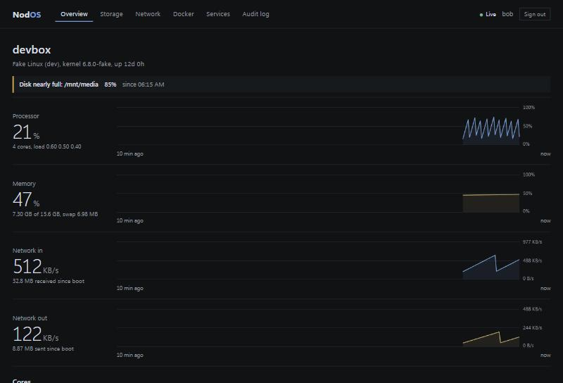
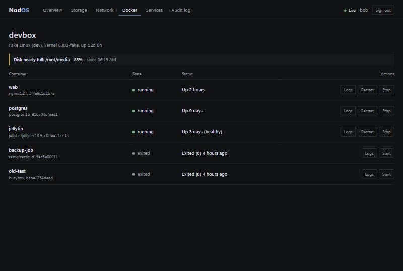
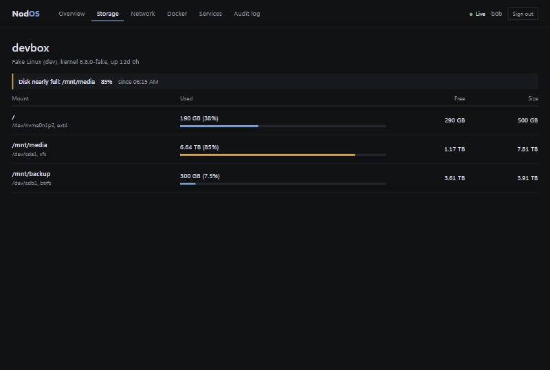

<p align="center">
  
</p>

<p align="center">
  A fast, minimal home server management platform written in Zig.
</p>

<p align="center">
  <a href="https://github.com/valerisn/NodOS/actions/workflows/ci.yml"></a>
  
  
  
  
</p>

> **Status: pre-alpha.** Everything below is built and tested, but there is no
> tagged release yet and it has not been run on a real home server for long.
> Read the [security notes](docs/security/README.md) before exposing it to
> anything. Release and download badges will appear with the first release.

<p align="center">
  
</p>

<p align="center">
  
  
</p>

<p align="center"><sub>Screenshots are from a development build with synthetic data (<code>-Dfake-host=true</code>), which is why the host is called <code>devbox</code>. The interface is the real one.</sub></p>

## What it is

One small static binary (under 0.7 MB) that watches your home server and lets
you manage it from a browser. No framework, no database server, no runtime
dependencies, no JavaScript build step. The dashboard is plain files compiled
into the binary.

## What works today

- **Monitoring** (Linux): CPU and per-core load, memory and swap, disk usage per
  mount, network throughput per interface, temperatures, load average, uptime.
  Ten minutes of history, pushed live over Server-Sent Events.
- **Alerts** for sustained high CPU, low memory, heavy swap, nearly full disks
  and high temperatures, with hysteresis so they don't flap.
- **Docker**: list containers, read logs, start, stop and restart.
- **systemd services**: status, logs, start, stop and restart for an allowlist
  of units you choose.
- **Updates**: a notice in the dashboard when a new release exists, and
  `sudo nodos update` to install it: signature and checksum verified, health
  checked after the restart, rolled back automatically if it does not come up.
  An opt-in auto-update exists; read the warning before using it.
- **Accounts**: argon2id passwords, admin and viewer roles, sessions, CSRF
  protection, login throttling, and an append-only audit log of everything
  that changes something.

Not built yet: outbound notifications (email, webhook), Docker stats and
images, VM management, multiple servers, user management in the browser. See
the [roadmap](ROADMAP.md).

## Quick start

You need Linux with systemd and [Zig 0.17.0](https://ziglang.org/download/) to
build it.

```sh
git clone https://github.com/valerisn/NodOS.git
cd NodOS
zig build -Doptimize=ReleaseSafe -Dstrip=true
sudo scripts/install.sh zig-out/bin/nodos
printf '%s\n' 'a long passphrase' | sudo -u nodos nodos user add YOURNAME --config /etc/nodos/nodos.conf
sudo systemctl enable --now nodos
```

Then open `http://127.0.0.1:8080` (through an SSH tunnel, or a TLS reverse
proxy for anything else). The [installation guide](docs/installation/README.md)
covers TLS with Caddy or nginx, Docker access, service control with polkit,
upgrading and uninstalling.

## Privacy

By default NodOS makes one outbound connection (a second only if you configure
`webhook_url` for alert messages): about every twelve hours it asks GitHub
whether a newer release exists, sending only a `nodos/<version>` User-Agent.
Set `update_check = false` to turn that off. Nothing about your machine is ever
sent anywhere.

## Security in one paragraph

NodOS never runs a command you type: Docker and systemd actions are three
fixed verbs on validated names, and everything privileged is admin-only,
CSRF-protected and audited. It runs as an unprivileged user under a hardened
systemd unit and speaks plain HTTP on loopback by default, so put TLS in front.
Docker socket access is root-equivalent no matter what NodOS restricts itself
to; you can turn it off. The [security document](docs/security/README.md) lists
the controls, the known limitations and a checklist for operators. It is a
self-review, not an audit.

## Documentation

| | |
| --- | --- |
| [Installation](docs/installation/README.md) | Install, TLS, Docker, services, upgrade |
| [Configuration](docs/configuration/README.md) | Every setting and the user commands |
| [API](docs/api/README.md) | Every endpoint, with roles and status codes |
| [Architecture](docs/architecture/overview.md) | How it fits together, and the [decisions](docs/architecture/decisions.md) behind it |
| [Security](docs/security/README.md) | Model, controls, limitations |
| [Troubleshooting](docs/troubleshooting/README.md) | Common problems |
| [Development](docs/development/README.md) | Build, test, work without a Linux box |
| [Performance](docs/development/performance.md) | What was measured, and what wasn't |

## Platforms

Host monitoring is Linux only (x86_64 and aarch64). The binary builds for
macOS and Windows and runs the CLI and web server there, but with no host data,
so the dashboard shows "no data". CI builds every target and runs the full
suite on Linux, macOS and Windows, plus an end to end smoke test and a real
install under systemd on Ubuntu.

## Contributing

Read [CONTRIBUTING.md](CONTRIBUTING.md) and the
[code of conduct](CODE_OF_CONDUCT.md). Development needs only Zig 0.17.0.

## Reporting a vulnerability

Privately, as described in [SECURITY.md](SECURITY.md).

## License

[MIT](LICENSE). See [NOTICE](NOTICE) and the [legal page](docs/legal/README.md) for the disclaimer, privacy, trademark and contributor terms.
